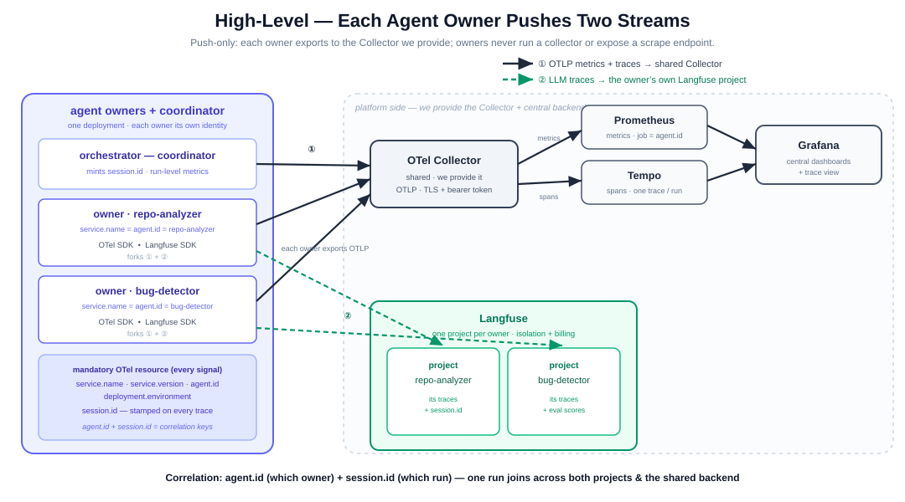
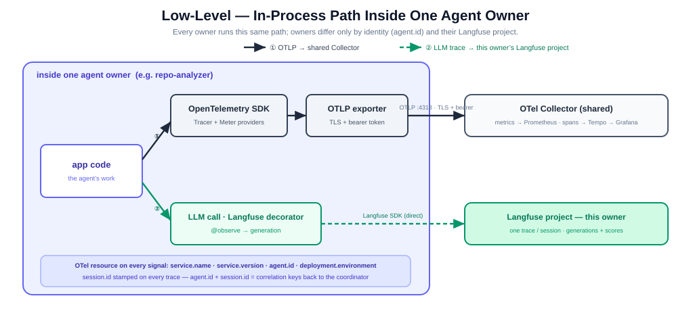

# Observability Integration Contract — Agent Owners

The **agent-service platform** hosts independent **agent owners** (units). Each owner
instruments its own code and exports telemetry; owners never run a collector and never
expose a scrape endpoint (telemetry is **push-only**). The platform provides one shared
Collector and issues each owner its own Langfuse project. An **orchestrator** (the platform
coordinator) mints one `session.id` per run and coordinates the owners. Two independent streams:

1. **Stream ① — OTLP metrics + spans** (bearer-token authenticated) → shared OTel Collector →
   **Prometheus** (metrics) / **Tempo** (spans) → **Grafana** (dashboards + trace view).
2. **Stream ② — LLM traces** → **each owner's own Langfuse project**, via the Langfuse SDK (direct).

Two owners ship in this reference: **`repo-analyzer`** and **`bug-detector`**.

<!-- ============================= PAGE 1 ============================= -->

## Page 1 — Architecture

### High-level



### Low-level (in-process)



**Mandatory on every signal:** `service.name` · `service.version` · `agent.id` ·
`deployment.environment` (OTel resource, from `OTEL_RESOURCE_ATTRIBUTES`) and `session.id`
(minted by the orchestrator, stamped on the owner's trace). **`agent.id` + `session.id` are the
correlation keys** — `agent.id` identifies the owner, `session.id` joins one run across owners.

<!-- ============================= PAGE 2 ============================= -->

---

## §1 · Onboarding &amp; Connectivity Requirements&nbsp;&nbsp;🔒 **NORMATIVE**

> Every item below is **mandatory** before an agent owner is considered *onboarded*.

1. **Credentials.** Obtain the shared Collector's **OTLP bearer token** (`OTLP_BEARER_TOKEN` —
   the Collector rejects unauthenticated OTLP with `401`; the app presents it via
   `OTEL_EXPORTER_OTLP_HEADERS`) and **your own Langfuse project keys** (issued by the platform
   at onboarding: `LANGFUSE_PUBLIC_KEY` / `LANGFUSE_SECRET_KEY` + `LANGFUSE_HOST`). Store them in
   `.env` (template: `.env.example`). *TLS is a deploy-time step: the same env vars switch to
   `https://` + the platform certificate — no code change.*
2. **SDKs.** Install `opentelemetry-sdk`, `opentelemetry-exporter-otlp-proto-http`, `langfuse`.
3. **Identity.** Give the owner its own OTel resource: `service.name` **=** `agent.id` **=** your
   owner id (`repo-analyzer` / `bug-detector`), plus `service.version` and
   `deployment.environment`. One owner = one identity across metrics, spans, and its Langfuse project.
4. **Session propagation.** We hand you a `session.id` per run; wrap your work in
   `propagate_attributes(session_id=…, environment=…)` so every observation is stamped with it.
5. **Own trace.** Wrap your run root in `@observe()` and each LLM call in
   `@observe(as_type="generation")` — your run is **one trace per session** in **your own project**,
   with LLM calls as generations. Every trace carries `agent.id` + `session.id` (for cross-owner joins).
6. **Stream separation.** Init Langfuse with `blocked_instrumentation_scopes=["<your-agent>.tracer"]`
   so your stream-① OTel spans don't duplicate into Langfuse.
7. **Flush on exit.** Flush the Langfuse client and `shutdown()` the OTel providers before exit
   (both streams batch in the background).
8. **Verification (definition of “onboarded”).** Run once; an owner is onboarded only when **both**
   appear on our side: its **metric** (labelled `agent.id`) on Grafana/Prometheus **and** its
   **trace** (generations + `session.id`) in **its** Langfuse project.

---

## §2 · Telemetry Compliance Requirements&nbsp;&nbsp;🔒 **NORMATIVE**

**Every agent owner MUST emit these** — the baseline floor, **each labelled `agent.id`**:

| Metric (dot-style) | Type | Labels | Meaning |
|---|---|---|---|
| `agent.invocations` | counter | `agent.id` | Times this owner was invoked (its request count) |
| `agent.duration` | histogram | `agent.id` | Per-invocation latency (seconds) |
| `agent.errors` | counter | `agent.id`, `error.type` | Invocations that raised |
| `gen_ai.client.token.usage` | histogram | `agent.id`, `token.type`, `model` | LLM tokens |
| `llm.cost.usd` | counter | `agent.id`, `model` | Estimated LLM spend (USD) |

> **On `active sessions` and run totals.** The instruction's baseline also lists *active sessions*
> per unit. In this reference the **coordinator** receives the run and owns the session, so
> `sessions.active` — plus run-level `runs.total` / `run.duration` — is emitted by the coordinator,
> **not** by the owners. Owners emit the per-invocation baseline above and never manage sessions.

**Self-service extras** — optional; examples this reference actually emits (self-service, per the guidelines below):
`gen_ai.client.operation.duration`, `gen_ai.server.time_to_first_token`,
`gen_ai.finish_reasons` (all `model`-labelled), and `eval.bug_recall` / `eval.judge_quality`
(the bug-detector's run-quality scores, 0..1).

**Langfuse rules.** Each owner emits to **its own Langfuse project**. **One trace per session,
per owner**; spans per invocation/pass and per LLM call; generations carry model + token usage +
cost + (gated) content. Every trace is stamped with `agent.id` + `session.id`. Eval scores attach
to the owner's trace via the Scores API, keyed by that project's trace id.

> **Scope note — batch vs. service.** This reference is a **batch process** (one run per
> invocation, then exits); metrics flush every 5 s and at exit. A **long-running service**
> deployment MUST additionally emit `service.heartbeat` (continuous liveness) — not emitted here
> because a run-once process has no meaningful liveness to report.

### Reference implementation — real code (one owner)

```python
# ── env (your agent owner) ────────────────────────────────────────────────
#   OTEL_EXPORTER_OTLP_ENDPOINT = https://collector.us/        (we provide it; TLS)
#   OTEL_EXPORTER_OTLP_HEADERS  = Authorization=Bearer%20<OTLP_BEARER_TOKEN>
#   OTEL_RESOURCE_ATTRIBUTES    = service.name=<your-agent>,service.version=1.0.0,
#                                 agent.id=<your-agent>,deployment.environment=prod
#   LANGFUSE_HOST / LANGFUSE_PUBLIC_KEY / LANGFUSE_SECRET_KEY  (your own project keys)

import time
from opentelemetry import metrics
from opentelemetry.sdk.metrics import MeterProvider
from opentelemetry.sdk.metrics.export import PeriodicExportingMetricReader
from opentelemetry.exporter.otlp.proto.http.metric_exporter import OTLPMetricExporter
from opentelemetry.sdk.resources import Resource
from langfuse import Langfuse, observe, get_client, propagate_attributes

AGENT_ID = "your-agent"                        # = service.name = agent.id
L = {"agent.id": AGENT_ID}                     # every metric carries agent.id

# Stream ①: your OTel metrics -> OTLP -> the Collector we provide.
# Resource.create() reads OTEL_RESOURCE_ATTRIBUTES (service.name/version, agent.id, environment).
metrics.set_meter_provider(MeterProvider(resource=Resource.create(),
    metric_readers=[PeriodicExportingMetricReader(OTLPMetricExporter(), export_interval_millis=5000)]))
m = metrics.get_meter(AGENT_ID)

# the mandatory baseline — one instrument each (every series labelled agent.id)
invocations = m.create_counter("agent.invocations")
duration    = m.create_histogram("agent.duration", unit="s")
errors      = m.create_counter("agent.errors")
tokens      = m.create_histogram("gen_ai.client.token.usage", unit="{token}")
cost        = m.create_counter("llm.cost.usd")

# Stream ②: your Langfuse client -> your own project (keeps stream-① spans out of Langfuse).
Langfuse(blocked_instrumentation_scopes=[f"{AGENT_ID}.tracer"])

@observe(name="agent.run")                                   # one trace per session
def run(task, *, session_id):                                # session_id is handed to you per run
    with propagate_attributes(session_id=session_id, environment="prod", metadata=L):
        invocations.add(1, L)
        t0 = time.perf_counter()
        try:
            return call_llm(task, model="gpt-oss:20b")
        except Exception as e:
            errors.add(1, {**L, "error.type": type(e).__name__}); raise
        finally:
            duration.record(time.perf_counter() - t0, L)

@observe(name="llm.generate", as_type="generation")          # renders as a Langfuse generation
def call_llm(prompt, *, model):
    reply = provider.chat(model=model, prompt=prompt)         # your LLM call
    ml = {**L, "gen_ai.request.model": model}
    tokens.record(reply.in_tokens,  {**ml, "gen_ai.token.type": "input"})
    tokens.record(reply.out_tokens, {**ml, "gen_ai.token.type": "output"})
    cost.add(reply.in_tokens * PRICE_IN + reply.out_tokens * PRICE_OUT, ml)   # tokens x your price
    get_client().update_current_generation(                  # stream ②: tokens/cost -> Langfuse
        model=model, usage_details={"input": reply.in_tokens, "output": reply.out_tokens})
    return reply.text
```

*A host that co-locates several owners in one process (like our reference) instead uses one explicit `Langfuse(public_key=…)` client per project; a standalone owner needs only the simpler `@observe()` form above.*

### Guidelines (conventions every owner MUST follow)

- **Dot-style, stable metric names** — `<domain>.<metric>` (`agent.duration`, `gen_ai.*`, `eval.*`).
  Renames are breaking changes.
- **Always include `agent.id` + `session.id`** — `agent.id` on every metric and trace, `session.id`
  on every trace. These are the correlation keys back to the orchestrator.
- **No unbounded / high-cardinality label values** — no raw run ids, emails, or URLs in metric
  labels (`session.id` rides on traces, **not** on metrics).
- **Never put secrets or PII** in labels, span names, or Langfuse payloads. Content capture is gated
  by `OTEL_INSTRUMENTATION_GENAI_CAPTURE_MESSAGE_CONTENT` (set `false` for metadata-only).
- **Always set `service.version`** — regressions are tracked across releases.
- **New mandatory metrics are announced by the platform** (added to this contract first); **optional
  metrics are self-service** as long as they follow these conventions.
