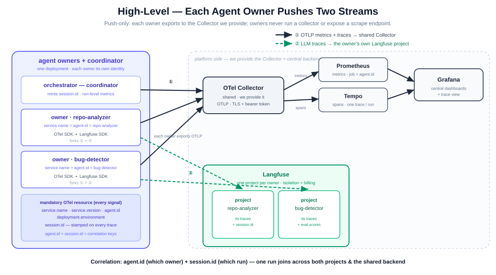
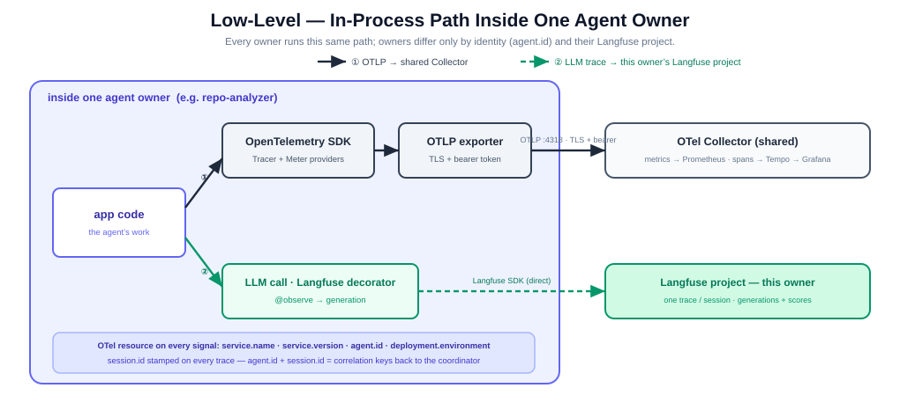

# Observability for an Agentic Application: Integrating OpenTelemetry with Langfuse

**Project:** agent-service
**Goal:** Build a health/observability system for a multi-agent LLM application and
document how **OpenTelemetry** and **Langfuse** integrate with it — complemented by
**Prometheus** and **Grafana** for the metrics/health view.

---

## 1. Executive summary

We built a small agentic application modelled as a **multi-owner platform**: an
**orchestrator** (coordinator) plus **two independent agent owners** — a **repo
analyzer** and a **bug detector**. Each owner is its own telemetry identity
(`service.name = agent.id`) with its **own Langfuse project**; the orchestrator mints
one `session.id` per run and coordinates them. This mirrors a real platform contract
(Session Manager + N independent units), defined normatively for agent owners in
[observability-contract.md](observability-contract.md). Two independent, push-only streams:

- **Stream ① — OTel SDK → OTLP (bearer-token) → shared Collector → Prometheus (metrics) /
  Tempo (spans) → Grafana** — operational health, per owner: each identity emits under its
  own `service.name` (Prometheus `job`) so cost, tokens, latency and quality split by owner;
  one Tempo trace per run nests every owner's spans.
- **Stream ② — Langfuse SDK → each owner's own Langfuse project, direct** — LLM-aware
  observability: each owner's run tree (its generations), prompts, completions, token usage,
  sessions, and (for the bug detector) evaluation scores.

The thesis, demonstrated end to end, is:

> **Independent owners, each with its own identity and Langfuse project, joined across a
> run by one `session.id` — metrics through a shared Collector, LLM traces through each
> owner's Langfuse SDK client.**

No owner runs a collector or exposes a scrape endpoint; each only exports. (An earlier
iteration was a single service with one identity and one Langfuse project — §5.3 records
the move to the multi-owner design.)

---

## 2. The stack, and why each tool is present

| Tool | Category | Role in this project |
|------|----------|----------------------|
| **OpenTelemetry** | Instrumentation standard | The vendor-neutral SDK that emits traces + metrics from the app in a single, standard format (OTLP). |
| **OTel Collector** | Stream ① routing | Receives bearer-token-authenticated OTLP from the app; republishes metrics for Prometheus, forwards spans to Tempo. LLM traces do **not** pass through it. |
| **Langfuse (+ SDK)** | Stream ② — LLM observability + evals | Each owner's Langfuse client exports its LLM traces directly to its own Langfuse project (generations, sessions, scores). Purpose-built for agentic apps. |
| **Prometheus** | Metrics store | Time-series database for the health numbers. Pull-based scraping of the Collector. |
| **Tempo** | Stream ① trace store | Backend for the app's OTel spans, so Grafana can show span trees next to the metrics. |
| **Grafana** | Visualization | Dashboards over Prometheus + trace view over Tempo. Stores nothing itself — it is only the "eyes." |

**Tempo's history in this project** is itself a lesson: it was removed early (for a
single service its span tree duplicates the Langfuse trace), then **re-added** when we
adopted the platform contract — stream ① promises "metrics *and traces* → central
backend/dashboards," and Tempo is what makes the traces half real (a queryable store +
a Grafana trace view). Langfuse remains the *LLM* pane; Tempo is the *generic* one.

**Why keep Prometheus/Grafana at all if Langfuse has dashboards?** Langfuse cannot
store OpenTelemetry *metrics* (counters/histograms for latency, throughput, error
rate). OpenTelemetry is a *multi-signal* standard; a report that only showed
traces→Langfuse would miss half of what OTel is. Traces→Langfuse **and**
metrics→Prometheus/Grafana is the complete picture.

---

## 3. Architecture





<details><summary>Text form (fallback)</summary>

```
   agent-service platform  (orchestrator + 2 agent owners, each its own identity)
        │
        ├─ ① OTel SDK ──OTLP+bearer──►  shared Collector ──┬─►  Prometheus (metrics) ──► Grafana
        │      (per identity: job = service.name = agent.id)└─►  Tempo      (spans)   ──► Grafana
        │
        ├─ ② Langfuse SDK ──────────────────────────────►  Langfuse project: repo-analyzer
        └─ ② Langfuse SDK ──────────────────────────────►  Langfuse project: bug-detector (+ evals)
                                                            (both traces joined by session.id)
```

</details>

Deployment is local **Docker Compose** — 10 containers:

- Observability core: `otel-collector`, `tempo`, `prometheus`, `grafana`
- Langfuse (self-hosted v3): `langfuse-web`, `langfuse-worker`, `postgres`
  (app data), `clickhouse` (trace storage), `redis` (ingestion queue),
  `minio` (blob storage)

All configuration (secrets, keys, endpoints) lives in a single `.env` file shared
by both Docker Compose and the Python application.

---

## 4. The application

A run appears differently on each stream. **Stream ① (Tempo)** is one trace per run —
`orchestrator.run` nests every owner's spans, each attributed to its own `service.name`:

```
[agent-orchestrator] orchestrator.run       ROOT — owns the run (outcome, duration, session.id)
├── [repo-analyzer]  agent.repo-analyzer     summarizes the target codebase
│     └── chat gpt-oss:20b                    the model call
└── [bug-detector]   agent.bug-detector       finds likely bugs
      ├── chat gpt-oss:20b                     quick pass
      └── chat gpt-oss:20b                     thorough pass (only if escalated)
```

**Stream ② (Langfuse)** is one trace *per owner*, in that owner's **own project**, each
stamped with the same `session.id`:

```
project repo-analyzer:  agent.repo-analyzer  └─ llm.generate            [generation]
project bug-detector:   agent.bug-detector   ├─ detect.quick    └─ llm.generate
                                             └─ detect.thorough └─ llm.generate  + 2 eval scores
```

- **Workload:** `sample_repo/` — a tiny Python project with 6 deliberately planted
  bugs (mutable default argument, wrong discount math, division-by-zero,
  KeyError on unstocked sell, negative-stock, redundant `== True`).
- **LLM provider:** Ollama Cloud (free tier), model `gpt-oss:20b`, accessed via its
  OpenAI-compatible endpoint (`https://ollama.com/v1`). Originally scoped for Claude
  Haiku; switched to Ollama because it is genuinely free. The provider swap touched
  only `app/llm.py` — no change to the telemetry or the agents.

### Source layout

| File | Responsibility |
|------|----------------|
| `app/telemetry.py` | The three telemetry identities: `Platform` (orchestrator) + one `Agent` per owner, each with its own OTel providers, metric instruments, and (agents) its own Langfuse client. `Agent.run_trace()` opens an owner's per-session trace on both streams; flush/shutdown per identity. |
| `app/llm.py` | The single instrumented model call, scoped to the calling owner — both streams: OTel `chat {model}` span + gen_ai metrics under the owner's identity, and a generation in the owner's Langfuse project. |
| `app/agents/repo_analyzer.py` / `bug_detector.py` | The two owners' work; per-invocation metrics. |
| `app/orchestrator.py` | Coordinator: mints `session.id`, opens each owner's trace, drives the feedback loop, owns run-level metrics. |
| `app/evaluation.py` | Offline eval: score findings vs the answer key; push scores to the **bug-detector's** own Langfuse project/trace. |
| `app/main.py` | Entry point (`python -m app.main`): builds the platform + two owner identities. |
| `docs/observability-contract.md` | The normative contract for agent owners (identity, streams, baseline metrics, code). |

---

## 5. The integration points (the substance)

### 5.1 Stream ① — OTel SDK → OTLP → Collector

Each identity configures its **own** `TracerProvider` + `MeterProvider` (see
`app/telemetry.py`), all exporting OTLP over HTTP to the **shared** Collector at
`localhost:4318`, with the mandatory resource attributes (`service.name` = `agent.id`,
`service.version`, `agent.id`, `deployment.environment`) on every signal. Prometheus is
configured with `honor_labels: true` so each series keeps the `job` = `service.name` the
Collector stamped — that is what makes the three identities distinct in the metrics store.
The Collector's pipelines (`infra/otel-collector-config.yaml`):

```yaml
service:
  pipelines:
    traces:   { receivers: [otlp], exporters: [otlp/tempo, debug] }   # app spans -> Tempo
    metrics:  { receivers: [otlp], exporters: [prometheus, debug] }
```

**Transport auth:** the Collector's OTLP receivers require a **bearer token**
(`bearertokenauth` extension; unauthenticated pushes get `401`). The app presents it via
the standard `OTEL_EXPORTER_OTLP_HEADERS=Authorization=Bearer%20<token>` env var — the
`%20` matters, because the SDK URL-decodes header values. TLS is a deploy-time step
(same env vars switch to `https://` + certificates).

LLM traces deliberately do **not** flow through the Collector — that is stream ②.

### 5.2 GenAI semantic conventions → Langfuse "generations" + cost

Each LLM span is named per convention `chat {model}` (e.g. `chat gpt-oss:20b`) and
carries the full **OpenTelemetry GenAI semantic-convention** attribute set:

```
gen_ai.operation.name        = "chat"
gen_ai.system                = "ollama"
gen_ai.request.model         = "gpt-oss:20b"
gen_ai.request.max_tokens    = 1024
gen_ai.response.model        = "gpt-oss:20b"
gen_ai.response.finish_reasons = ["stop"]
gen_ai.usage.input_tokens    = 691
gen_ai.usage.output_tokens   = 848
```

These spans feed the Collector (stream ①) under the owner's identity and keep the app
portable to any generic OTel trace backend. The *Langfuse-facing* generation (stream ②) is
created by the owner's own client — `lf.start_as_current_observation(as_type="generation")`
— and enriched with `gen.update(model=…, usage_details=…, cost_details=…, input=…, output=…)`
in that owner's project — so both streams carry the same facts about each call.

**Content gating (privacy).** Prompt/completion *content* is captured only when
`OTEL_INSTRUMENTATION_GENAI_CAPTURE_MESSAGE_CONTENT=true` (the standard GenAI env var).
Metadata (model, tokens, latency) is always captured; content — which may contain user
data — is opt-in, as production setups require.

### 5.3 Stream ② — Langfuse SDK, sessions, and stream separation

LLM traces reach Langfuse through the **Langfuse SDK**, not the Collector — and each
owner uses **its own Langfuse client** pointed at **its own project**. For each owner,
`Agent.run_trace(session_id)` opens an **independent, named trace** in that owner's
project (`start_as_current_observation(trace_context={"trace_id": create_trace_id()})`)
and the LLM call is a generation inside it. `propagate_attributes(session_id=…,
environment=…, trace_name=…)` stamps **`session.id`** (and a trace name) on that trace —
so a run is **two traces in two projects, joined by the shared `session.id`** (the
correlation key, exactly like `agent.id` + `session.id` in the platform contract).

Three integration realities worth recording:

- **Multi-project routing.** Two `Langfuse(...)` clients (one per project's keys) route
  by public key: each owner's observations land only in its project — verified live.
- **Stream bleed.** The Langfuse SDK observes the OTel context, so it could ingest our
  stream-① spans (duplicated trees). Fix: init every client with
  `blocked_instrumentation_scopes=[…all owner tracer scopes…]`, and give each identity its
  own (non-global) providers, keeping the streams disjoint.
- **Cross-stream nesting.** Opening the owner's Langfuse trace makes it the active
  context; the LLM `chat` OTel span would then inherit the *Langfuse* trace id instead of
  nesting under `orchestrator.run` in Tempo. Fix: capture the OTel span's context in
  `run_trace()` and start the `chat` span with it explicitly, so stream ① stays one clean
  Tempo trace while stream ② stays the owner's independent Langfuse trace.

Because each owner holds its own generation handle, enrichment is a direct
`gen.update(model=…, usage_details=…, cost_details=…)` — no reliance on a global
"current generation."

*(An earlier iteration was a single service with one identity, one Langfuse project, and
the `@observe` decorator on a global client. We adopted the multi-owner design so each
agent owner is an independent unit with its own identity and Langfuse project — the
platform-mirror the deliverable requires.)*

### 5.4 Metrics → Prometheus (pull) → Grafana

The Collector republishes received metrics on `:8889`; Prometheus **scrapes** it
every few seconds. Note the asymmetry: **traces are pushed**, **metrics are pulled**.
Grafana then queries Prometheus. Grafana stores nothing — it is purely a viewer, so
a storage backend between OTel and Grafana is mandatory, not optional.

Metrics split by identity. **The orchestrator (coordinator)** emits run-level metrics —
`runs_total{outcome}`, `run_duration_seconds`, `sessions_active`, `feedback_escalations` —
all under `job="agent-orchestrator"`. **Each agent owner** emits its own, labelled with
`agent.id` (and carried under `job=<owner>`): `agent_invocations_total`,
`agent_duration_seconds`, `agent_errors_total`, the **standard GenAI histograms**
`gen_ai.client.token.usage` (tokens by type), `gen_ai.client.operation.duration` (LLM call
latency), `gen_ai.server.time_to_first_token` (**TTFT**, captured by *streaming*),
`gen_ai.finish_reasons` (truncation detection), `llm_cost_usd_total{model}`, and — for the
bug detector — `eval_bug_recall` / `eval_judge_quality`. (`sessions.active` is a
mandatory-baseline concurrency gauge, owned by the coordinator that mints sessions; only
`service.heartbeat` is *not* emitted — a run-once batch process has no meaningful continuous
liveness, so it is scoped to long-running deployments.)

The 20-panel dashboard covers both standard observability frameworks:
- **RED method:** Rate (run throughput), Errors (error rate %), Duration (P95 latency).
- **GenAI-specific:** token usage, cost + **cost/run**, **TTFT P95**, **tokens/sec**
  throughput, finish-reason/truncation, and eval quality.

**P95** is computed with `histogram_quantile(0.95, sum by (le) (last_over_time(..._bucket[$__range])))`
— the `last_over_time` form is required because our runs are short-lived processes.

**Alerting.** `infra/alert-rules.yml` defines Prometheus alert rules (run failures,
P95 LLM latency > 25s, low eval quality, estimated-cost guardrail) that show in the
Prometheus `/alerts` page. Wiring Alertmanager for notifications is the production
next step; the rules are identical.

### 5.5 Evaluation ↔ trace, joined by trace ID

After a run, `app/evaluation.py` scores the findings **two complementary ways** and
attaches both scores — via the Scores API — to the **bug-detector's own** Langfuse trace,
in the **bug-detector's own project**, keyed by that trace id (`agent_bug.last_trace_id`,
captured when the owner's trace was opened). Evaluation is a quality signal for the
bug-detector unit, so it lives entirely in that owner's project:

1. **`bug_recall`** — deterministic checklist against the known planted bugs. Fast;
   also drives the online feedback loop.
2. **`llm_judge_quality`** — an **LLM-as-judge** score. A separate model call (the same
   Ollama model, with `reasoning_effort=low` and forced tool-calling for a clean 0–1
   result) grades the bug report, and the score is pushed to Langfuse. This is the
   professional way to give Langfuse a genuine LLM-based evaluation rather than only a
   keyword check.

```
bug-detector run_trace  ──►  trace_id = agent_bug.last_trace_id
POST /api/public/scores  (auth = bug-detector project keys)  { traceId, name: "bug_recall",        value }
POST /api/public/scores  (auth = bug-detector project keys)  { traceId, name: "llm_judge_quality", value }
```

The owner's Langfuse client writes the trace; the Scores API annotates that exact trace in
that project. The trace id (plus the run's `session.id`) keeps observability and evaluation
joined without bespoke glue.

**Why not Langfuse's *managed* LLM-as-judge?** Langfuse can run evaluators on its own
worker (configured via an LLM Connection + an evaluator + an evaluation rule). We set
this up and confirmed the Ollama judge works, but the managed path was impractical on
the free tier: the judge model's default reasoning made calls exceed Langfuse's 120s
preflight timeout, and the managed API exposes no hook to reduce reasoning. Running the
judge in-app (with `reasoning_effort=low`) sidesteps this and still lands a real
LLM-judge score in Langfuse — a pragmatic, common production choice.

### 5.6 Online feedback loop (observe → evaluate → act)

The orchestrator scores the detector's output **mid-run** and acts on it. The bug
detector supports two modes: a cheap **quick** pass (name 1–2 obvious bugs) and a
**thorough** pass. The orchestrator runs quick first, scores it inline, and escalates
to thorough only when recall is below a threshold (0.9):

```
analyze → detect(quick) → score → recall ≥ 0.9 ? ── yes → done
                                        │ no
                                        ▼
                              detect(thorough) → keep the better result
```

This "cheap-first, escalate-on-low-quality" pattern is a real cost-control technique:
the expensive call is spent only when needed. Both attempts appear as separate
`detect.quick` / `detect.thorough` observations (tagged `mode`, `attempt`) under the
**single bug-detector trace**, and the orchestrator records `feedback.recall_initial/final`
on its run span — so the entire loop is observable. An escalation also increments the
coordinator's `feedback.escalations` metric.

Here the mid-run signal is the deterministic scorer (we have ground truth). In a system
without an answer key, that signal would come from an LLM-judge or a Langfuse eval — the
loop architecture is identical.

---

## 6. Lessons learned (integration gotchas)

1. **Grafana is not a database.** It stores nothing and can only visualize a backend
   (Prometheus here). You cannot "send metrics to Grafana"; you send them to a store
   that Grafana reads.

2. **Push vs pull.** Traces are pushed (app→Collector→Langfuse). Metrics are pulled
   (Prometheus scrapes the Collector). Same Collector, opposite directions.

3. **Short-lived processes break `increase()`/`rate()`.** Each run is a fresh process
   with a new `service.instance.id`, so each Prometheus counter series is *born at its
   final value and never changes*. `increase()` measures growth within a series and
   therefore returns **0**. The fix is `last_over_time(metric[$__range])` summed across
   series. This is a genuine mismatch between Prometheus counter semantics (built for
   long-running services) and many independent one-shot agent runs.

4. **Batch exporters must be flushed on exit.** `BatchSpanProcessor` and the periodic
   metric reader export in the background; a short-lived script must call
   `provider.shutdown()` (we also register it with `atexit`) or the last batch is lost.

5. **Standard attribute names matter.** `gen_ai.*` conventions unlock Langfuse's
   automatic generation/cost handling; off-standard names render as plain spans.

6. **Provider portability.** Because instrumentation is separate from the LLM call,
   swapping Anthropic → Ollama Cloud touched only `app/llm.py`. The traces, metrics,
   dashboards, and evals were unaffected.

7. **Cost is modeled, not billed.** Ollama's free tier meters GPU-time, not tokens,
   so real cost is $0. We track an *estimated* cost (`tokens × representative price`)
   so the cost panel is meaningful — clearly labeled "estimated," not a real invoice.

8. **Environment friction is real.** Windows' legacy console codepage (cp1254) could
   not print some characters the model emitted; forcing UTF-8 stdout fixed it. Also,
   Python 3.14 lacked wheels for the gRPC OTLP exporter, so we used the HTTP exporter.

9. **Managed evals are async and have preflight limits.** Langfuse's built-in
   LLM-as-judge runs on its worker and validates the model with a 120s preflight. A
   slow/reasoning judge on a free tier exceeds that, and the managed config exposes no
   way to tune the judge's latency. Running the judge in-app (fast settings) and pushing
   the score via the Scores API is the reliable alternative — Langfuse still owns the
   evaluation record.

---

## 7. Results

- **Correctness:** on `gpt-oss:20b`, the bug detector found **6/6** planted bugs
  (100% recall), plus occasional legitimate extra findings.
- **Observability (per owner):** every run produces **two independent Langfuse traces**
  (one per owner, in its own project) carrying real model + token data, plus **one Tempo
  trace** nesting both owners' spans — all joined by the same `session.id`.
- **Health:** a 20-panel Grafana dashboard covering RED (rate/errors/duration) and
  GenAI-specific metrics, now **split by owner** (`agent.id`) for tokens, cost, and
  latency — plus TTFT P95, tokens/sec, error rate, cost/run, finish reasons, eval quality,
  and a Tempo trace-view panel. Prometheus alert rules fire on threshold breaches.
- **Evaluation:** each run gets two scores on the **bug-detector's** Langfuse trace — a
  deterministic `bug_recall` and an LLM-as-judge `llm_judge_quality` — both charted in Grafana.
- **Online feedback:** the orchestrator escalates from a cheap to a thorough pass
  when mid-run recall is low; both attempts and the decision are visible in the trace.

---

## 8. Future work

- **Auto-instrumentation:** swap hand-written `gen_ai.*` attributes for an
  auto-instrumentation library (OpenLIT / OpenLLMetry / OpenInference) that emits the
  GenAI conventions automatically. A common professional convenience; our manual
  instrumentation is already convention-complete, so this is a lateral (not corrective)
  change that trades transparency for less boilerplate.
- **Alertmanager:** wire notifications (Slack/email) onto the existing alert rules.
- **Harder workload:** a larger sample repo with subtler bugs, so quality varies more.
- **MCP / tool spans:** if agents gain tools, add `execute_tool` spans per the newer
  OTel MCP conventions.

---

## Appendix — how to run

```bash
docker compose up -d                      # start the 10-container stack
python -m venv .venv
.venv/Scripts/python -m pip install -r requirements.txt
# one-time: create two Langfuse projects (repo-analyzer, bug-detector) in the UI and
# paste their key pairs into .env (LANGFUSE_REPO_* / LANGFUSE_BUG_*); add OLLAMA_API_KEY
.venv/Scripts/python -m app.main          # run one instrumented, evaluated run
```

- Langfuse UI: http://localhost:3000  (two projects: repo-analyzer, bug-detector — Tracing + Scores)
- Grafana:     http://localhost:3001  ("agent-service — Multi-Owner Health Overview")
- Prometheus:  http://localhost:9090
